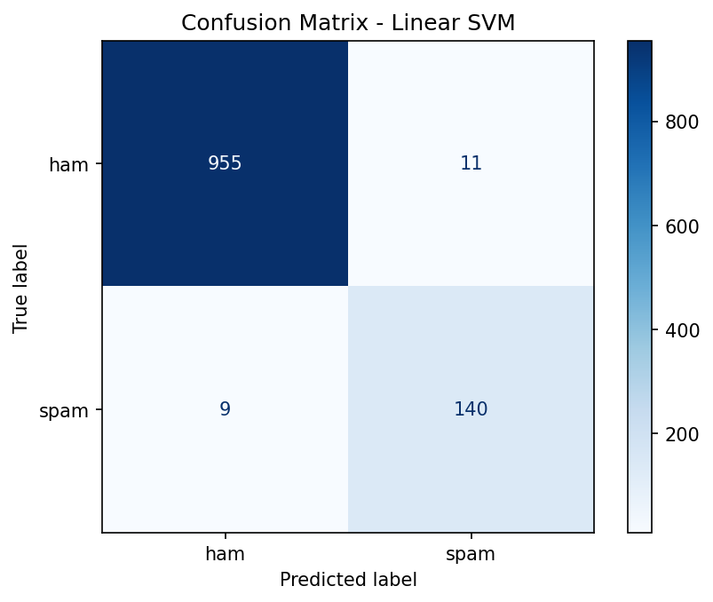

# 📩 SMS Spam Classifier

A machine learning web app that classifies SMS messages as **spam** or **ham** (not spam).

🔗 **Live demo:** https://spam-classifier-bs7w99rmbftlkhamrcrtzz.streamlit.app

## Overview
- **Dataset:** [SMS Spam Collection (Kaggle)](https://www.kaggle.com/datasets/uciml/sms-spam-collection-dataset), about 5,500 messages (~13% spam)
- **Preprocessing:** lowercasing, URL/number normalisation, punctuation and stop-word removal
- **Features:** TF-IDF (unigrams + bigrams)
- **Models compared:** Multinomial Naive Bayes, Logistic Regression, Linear SVM
- **Metric focus:** Precision / Recall / F1 on the spam class (dataset is imbalanced, so accuracy alone is misleading)
- **Deployment:** Streamlit

## Results
| Model | Accuracy | Spam Precision | Spam Recall | Spam F1 |
|-------|----------|----------------|-------------|---------|
| Naive Bayes | 97.6% | 100.0% | 81.9% | 0.90 |
| Logistic Regression | 96.1% | 80.0% | 94.0% | 0.86 |
| **Linear SVM (best)** | **98.2%** | **92.7%** | **94.0%** | **0.93** |

Linear SVM gave the best precision/recall balance (highest F1). Naive Bayes never flagged a normal message as spam (100% precision) but missed more spam, while Logistic Regression caught spam well but produced more false alarms.



## Run locally
```bash
git clone https://github.com/Shashini-fernando08/spam-classifier.git
cd spam-classifier
pip install -r requirements.txt
# put spam.csv from Kaggle into data/
python train.py
streamlit run app.py
```

## Project structure
```
spam-classifier/
├── data/spam.csv
├── train.py
├── app.py
├── model.pkl
├── confusion_matrix.png
├── requirements.txt
└── README.md
```

## Future improvements
- Try a transformer model (DistilBERT)
- Add explainability (top spam words)
- Support Sinhala/Singlish messages

## Author
_Shashini Fernando_ | SLIIT, BSc (Hons) in Information Technology
